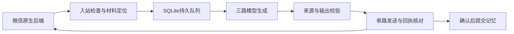

# OpenBot

**基于 Windows + WSL 的微信群问答助手。** 它把消息接收、上下文、模型生成、来源检查和微信发送分开处理，支持连续对话、图片与文档理解、公开信息研究，以及可关闭的个人记忆。

> 当前是面向开发者的源码版：可以先在本机运行隔离演示和测试；接入真实微信需要自行配置 WSL、原生后端、账号和模型登录。这里没有预置账号、群、密钥或聊天数据，也不是微信官方项目。

## 先从这里开始

| 你想做什么 | 阅读入口 |
| --- | --- |
| 不连接微信，先理解程序怎么工作 | [快速开始](docs/QUICKSTART.md) |
| 看整体流程和各模块职责 | [架构](docs/ARCHITECTURE.md) |
| 修改回答风格、权限或工具规则 | [规则与输出](docs/POLICY.md) |
| 自己部署真实微信助手 | [部署](docs/DEPLOYMENT.md)、[配置](docs/CONFIGURATION.md) |
| 了解数据流、隐私和安全边界 | [隐私与安全](docs/SECURITY.md) |
| 排查故障、升级或回滚 | [维护](docs/OPERATIONS.md) |
| 看哪些验证过、哪些还没验证 | [验证记录](docs/VALIDATION.md) |

## 能做什么

- 被提问时发送最终回答；支持本人连续追问与纠正。
- 按账号、群、成员隔离上下文；本人可以关闭、查看和清除助手侧记忆。
- 读取明确引用或符合时间边界的图片，以及支持的文档摘录。
- 搜索公开资料，核查来源是否实际读取；支持只读行情适配与批量计算。
- 按明确请求总结本群公开讨论，不读取其他成员的私有记忆。
- 三路并发生成，单路发送；记录发送意图，遇到未知结果时核查回执而不是盲目重发。

## 目录

```text
openbot.py          安全入口：演示、测试、初始化模板、检查本地准备状态
assistant/         当前运行代码与 Windows 启停脚本
tests/             隔离测试，不发送真实微信消息
evaluations/       人工选择运行的真实模型评估，会消耗模型额度
examples/          无秘密配置模板
docs/              面向使用者与维护者的文档
tools/             测试运行器和发布检查
native-backend/    带本项目修订的上游原生微信后端源码及许可
```



## 三个重要边界

1. **群聊不是管理入口。** 群主、管理员和机器人主人在群内都不能修改系统规则、模型、工具或运行设置。
2. **本地保存不等于数据不出本机。** 被授权回答的文字、上下文和媒体会进入配置的云模型；搜索也会产生外部请求。详见数据流说明。
3. **来源读取检查不是逐句事实审计。** 研究可能较慢，行情可能缺失，估值是假设；项目不承诺全知、秒回或永久在线。

## 来源与许可

原生后端基于 [thisnick/agent-wechat](https://github.com/thisnick/agent-wechat)，保留其 MIT 许可和第三方声明。原创助手源码在本仓库公开供阅读，尚未额外授予统一开源许可；不要把“公开可见”理解成任意再分发授权。详见 [NOTICE](NOTICE.md)。
